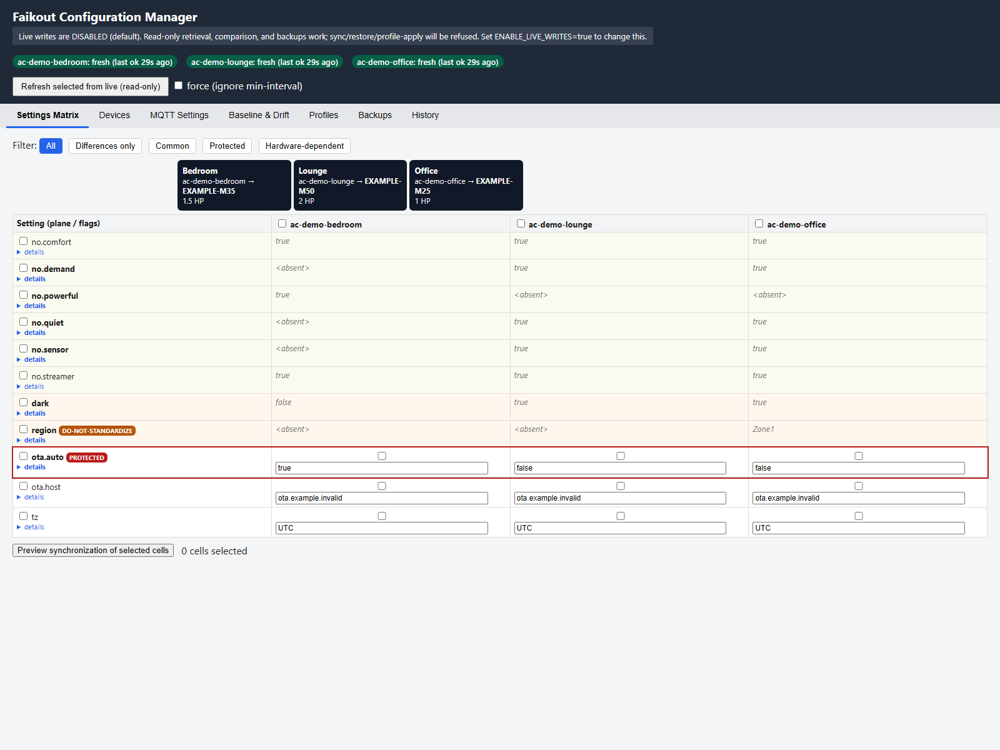
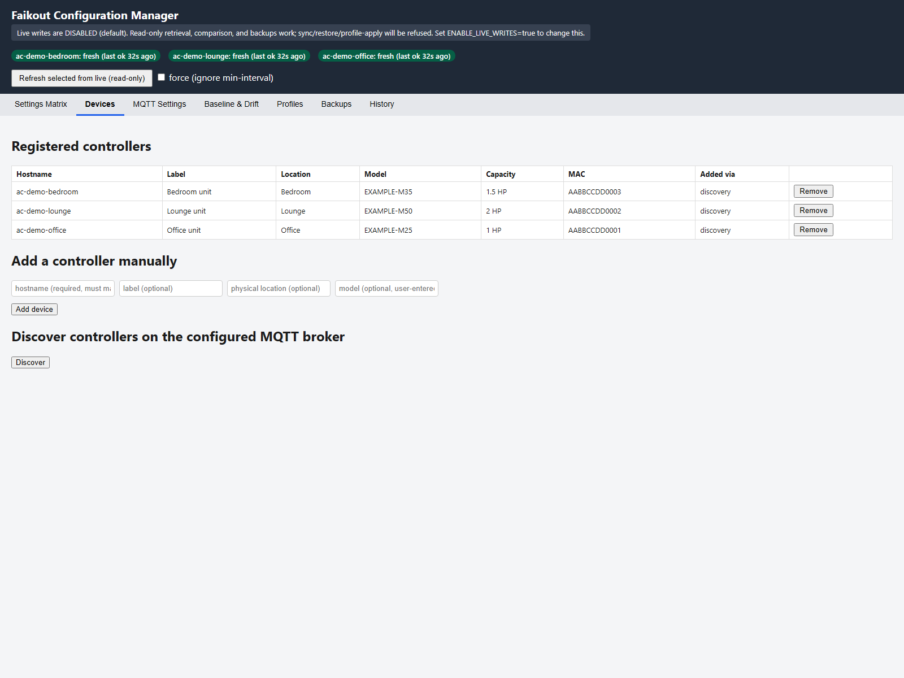
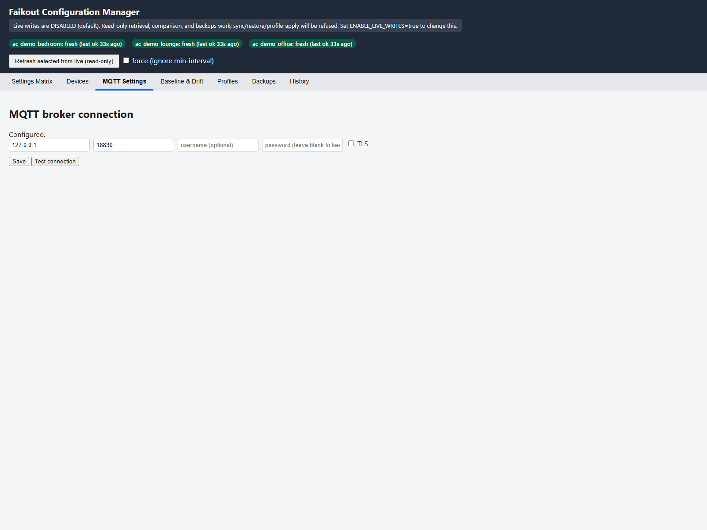
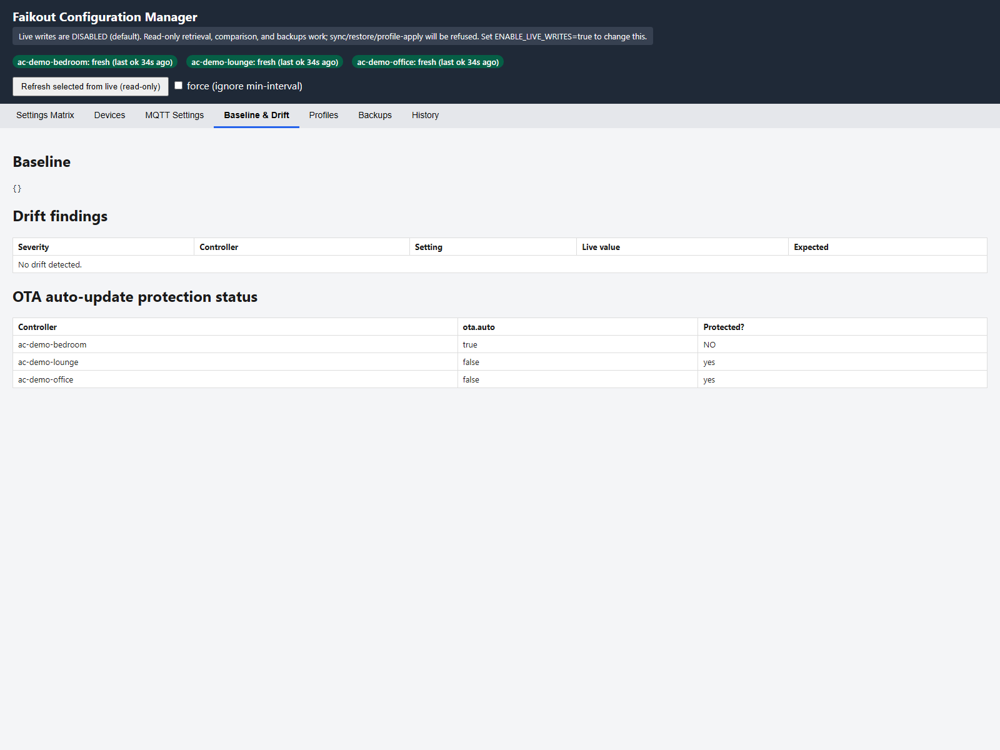
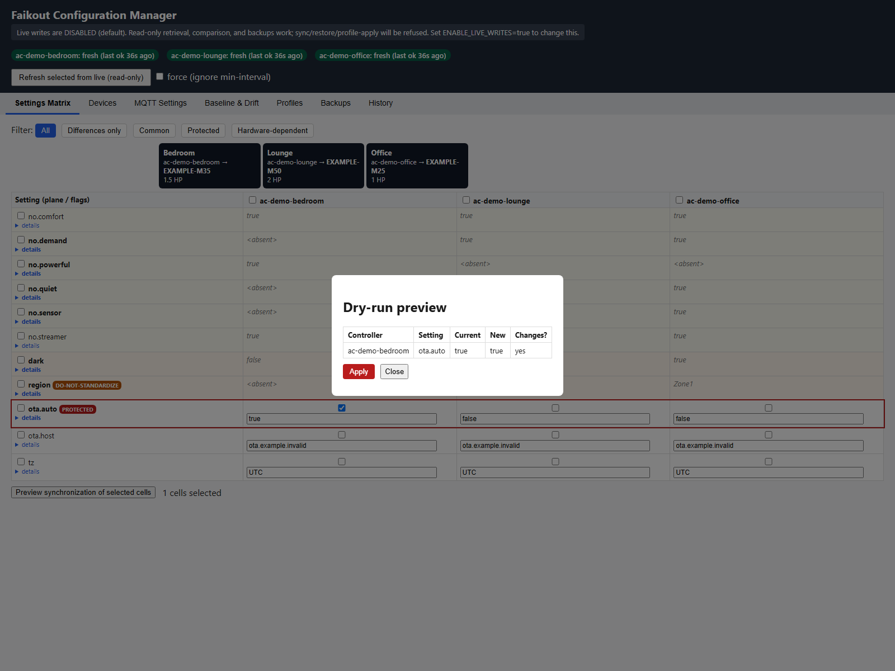

# Faikout Configuration Manager

A self-hosted web UI and CLI for managing a fleet of [RevK Faikout](https://github.com/revk/Faikout)
AC controllers over MQTT: a settings matrix across all your controllers,
drift detection against a declared baseline, named profiles, automatic
pre-change backups, and dry-run previews before anything gets written.

Built for owners of multiple Faikout-based Daikin AC units who got tired of
manually comparing settings controller-by-controller, and wanted a safety net
(backups, readback verification, rollback) before ever touching a live
setting.



## Why this exists

A Faikout controller exposes dozens of settings over MQTT, but they aren't
all the same *kind* of setting:

- **Plane A -- live state** (temperature, mode right now)
- **Plane B -- detected hardware capability** (the `no.*` map: what the
  connected AC can physically do) -- read-only, never a sync target
- **Plane C -- device identity/wiring** (hostname, UART pins, I2C pins) --
  never copied between different physical devices
- **Plane D -- true configuration** (timezone, display, OTA host, region) --
  the only plane this tool will ever write to, and only when you explicitly
  ask it to

This classification (`faikout_config/planes.py`) is the foundation everything
else is built on: the matrix, sync, backup/restore, and drift detection all
reason in terms of these four planes so that, for example, "copy this
setting to another controller" simply isn't offered for a plane-B or plane-C
key, rather than relying on the user to remember not to.

## Features

- **Dynamic settings matrix** -- add/remove controllers and the matrix grows
  or shrinks automatically; filter by All / Differences only / Common /
  Protected / Hardware-dependent.
- **Device management** -- add controllers manually or discover them via
  standard Home Assistant MQTT discovery messages; no source-code changes
  needed to add a device.
- **Backup & restore** -- full or partial snapshots per controller, same-
  device or cross-device restore (cross-device restore automatically
  excludes capability/identity keys).
- **Named profiles** -- save a set of plane-D settings once, apply to any
  subset of your fleet later.
- **Drift detection** -- declare a baseline + approved exceptions, see what's
  actually drifted on live hardware.
- **Dry-run preview before every write** -- see current vs. new value and
  any validation problems before anything is sent.
- **Automatic pre-change backup + readback verification + rollback** on
  every write path.
- **Firmware-update protection that can't be bypassed from the UI**: no
  sync/restore/profile-apply call can ever set `ota.auto` to a truthy value,
  in any form (bool, int, or the string forms an HTML input actually sends).
- **Live writes are off by default**, gated by a single environment variable
  (`ENABLE_LIVE_WRITES=true`) -- not a per-action UI toggle.
- **Bring your own MQTT broker** -- configure it from the web UI, no
  Home-Assistant dependency required (though an HA-WebSocket transport is
  also available if you already run HA).
- **CLI** (`faikout-config`) for scripting: `matrix`, `devices`,
  `device-add`, `device-remove`, `mqtt-set`, `drift-check`, `backup`.

## Prerequisites

This tool manages the settings of Faikout controllers that are *already*
flashed and already connected to an MQTT broker -- it does not flash
firmware, provision Wi-Fi, or set up a broker for you. Before you start, you
need:

- One or more [RevK Faikout](https://github.com/revk/Faikout)-firmware AC
  controllers, already on your network and already publishing to an MQTT
  broker (this is standard Faikout setup, done once per controller when you
  first flash/configure it).
- That same MQTT broker's address, port, and credentials (if any) -- this
  tool connects to your existing broker, it doesn't run one for you.
- Docker, or Python 3.10+, depending on which install path you choose below.

## Screenshots

| Settings matrix | Device management |
|---|---|
|  |  |

| MQTT connection settings | Baseline & drift / OTA protection |
|---|---|
|  |  |

| Dry-run sync preview |
|---|
|  |

(All screenshots above use fully synthetic demo data -- see `examples/`.)

## Quickstart -- Docker (recommended)

```bash
git clone https://github.com/jaspweowaale/faikout-config-manager.git
cd faikout-config-manager
docker compose up -d
```

Open `http://localhost:8765/` (or `http://<the machine's LAN address>:8765/`
if you're running this on a server and browsing from elsewhere). In the
terminal where you ran `docker compose up`, find the auto-generated admin
password -- it's written once to `/data/auth.json` inside the named volume
and never printed to a log, so read it directly:

```bash
docker compose exec faikout-config-manager cat /data/auth.json
```

Then go to **MQTT Settings** and connect your broker. That's it -- read-only
retrieval, comparison, and backups all work immediately. Live writes stay
disabled until you explicitly set `ENABLE_LIVE_WRITES=true` in
`docker-compose.yml` (see [SECURITY.md](SECURITY.md) first).

## Quickstart -- native Python

Requires Python 3.10+.

```bash
git clone https://github.com/jaspweowaale/faikout-config-manager.git
cd faikout-config-manager
python3 -m venv .venv
source .venv/bin/activate        # .venv\Scripts\activate on Windows
pip install -r requirements.txt
python3 webui/app.py
```

By default this listens on port 8765 and stores its data under
`~/.faikout_config_manager/` (override with the `FAIKOUT_CM_DATA_DIR`
environment variable). The admin password is generated on first run --
read it from `~/.faikout_config_manager/auth.json`.

## Full guide

See [docs/USER_GUIDE.md](docs/USER_GUIDE.md) for a walkthrough of every tab,
the CLI, and how backup/restore/profiles/drift-detection fit together.

## Safety model

Read [SECURITY.md](SECURITY.md) before enabling live writes or exposing this
outside a trusted LAN.

## License

MIT -- see [LICENSE](LICENSE).

## Contributing

See [CONTRIBUTING.md](CONTRIBUTING.md).
